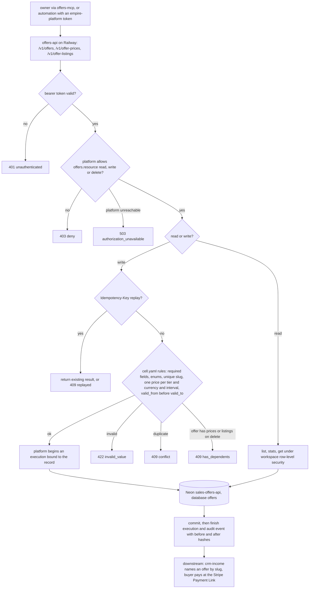
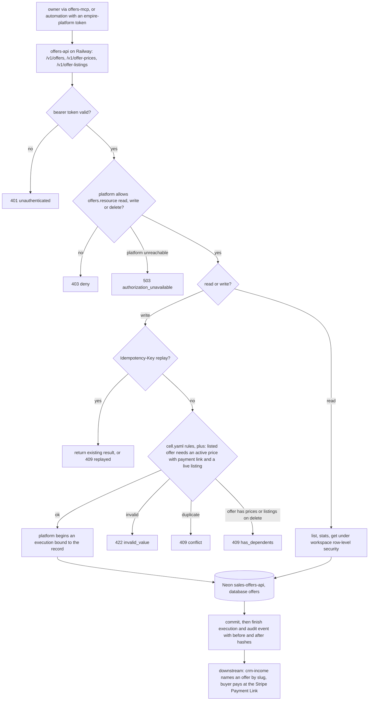

# 01 — Business process (As-Is / To-Be)

sales-offers-api คือ Offers cell: แค็ตตาล็อกว่า Solo Empire ขายอะไร ราคาเท่าไร ชำระผ่าน payment link ไหน และวางขายที่ช่องทางใด (offer, offer-price, offer-listing) ผู้ใช้คือ owner ผ่าน `offers-mcp` และ automation ที่ถือ token ของ `empire-platform`; การรับเงินเกิดที่ provider ไม่ใช่ที่นี่

Last reviewed: 2026-11-27 · commit `6cb710c`

## As-Is (จากโค้ดวันนี้)

Sources: `cell.yaml`, `migrations/0001_offers.sql`, `pyproject.toml` (entry points use `platform-cellkit` v1.0.11: `cellkit.server`, `cellkit.app`), `tests/test_offer_rules.py`, `tests/test_contract.py`, `.github/workflows/ci.yml`, `README.md`, `PRODUCT.md`

ข้อเท็จจริงจากโค้ดและเอกสาร:

- โค้ด request flow อยู่ใน package `platform-cellkit` ไม่ใช่ใน repo นี้ (ย้ายออก 2026-11-12); repo นี้มีแค่ `cell.yaml` (schema + กฎ), migration, tests และ CI/deploy
- ราคาแต่ละแถวมี `payment_link_url` เป็น field ที่ไม่ได้บังคับ (ยาวไม่เกิน 500) และ `offer.status = listed` ไม่ถูกผูกกับการมีราคา active หรือ listing `live` ในโค้ดที่เห็น [ต้องยืนยัน] ว่า platform-cellkit ไม่มีกฎข้ามตาราง
- deploy: merge เข้า `main` → CI + security ผ่าน → job `deploy` ทำ `railway up` แล้ว smoke-test `/health` เมื่อตัวแปร repo `CD_DEPLOY` เป็น `true` (ค่าจริง [ต้องยืนยัน])
- การจ่ายเงิน ใบแจ้งหนี้ และใบเสร็จอยู่นอก scope (provider และ `crm-income`)

## To-Be (จาก `PRODUCT.md` §Product Purpose และ §Measures)

เป้าหมายที่เขียนไว้คือ ทุก offer ที่แสดงให้ผู้ซื้อต้องมีราคา active พร้อม payment link และอย่างน้อยหนึ่ง listing ที่ live และห้ามขายจากราคาที่ไม่อยู่ในแค็ตตาล็อก; ตัวชี้วัดเป้า 0 สำหรับ offer ที่ `listed` แต่ไม่มีราคา active และราคา active ที่ไม่มี payment link

Sources: `PRODUCT.md`

## Gap

| ID | As-Is → To-Be | Status | Owner | Evidence |
|---|---|---|---|---|
| G1 | `offer.status = listed` ไม่ถูกตรวจว่ามีราคา active และ listing live (ไม่พบกฎใน `cell.yaml`) → offer ที่ listed ต้องมีทั้งสอง (เป้า 0 offer ที่ listed แต่ไม่มีราคา active) | todo | claude | `PRODUCT.md` §Measures; `cell.yaml` |
| G2 | `payment_link_url` ของราคาไม่บังคับ → ราคา active ทุกแถวมี payment link (เป้า 0) | todo | claude | `PRODUCT.md` §Measures; `cell.yaml` offer-price |
| G3 | ไม่มีการวัดตัวชี้วัดใน repo (offers ต่อ stream ที่มี live listing, 5xx และ p95 ของ `/v1/offers`) → ตัวชี้วัดถูกอ่านจากที่ใดที่หนึ่ง [ต้องยืนยัน] | decide | owner | `PRODUCT.md` §Measures |
| G4 | CI coverage gate 50% หลังย้าย kit ออก (DoD exception) → ไม่มี To-Be ที่เขียนไว้ว่าจะกลับมาเป็นเท่าไร | decide | owner | `.github/workflows/ci.yml` |

## Open questions

- กฎข้ามตาราง (listed ต้องมีราคา) ควรอยู่ใน `cell.yaml`/platform-cellkit หรือเป็น process ฝั่ง owner
- `CD_DEPLOY` ของ repo เป็น `true` อยู่หรือไม่ (README บอกว่า job เปิดเมื่อเป็น `true`) [ต้องยืนยัน]
